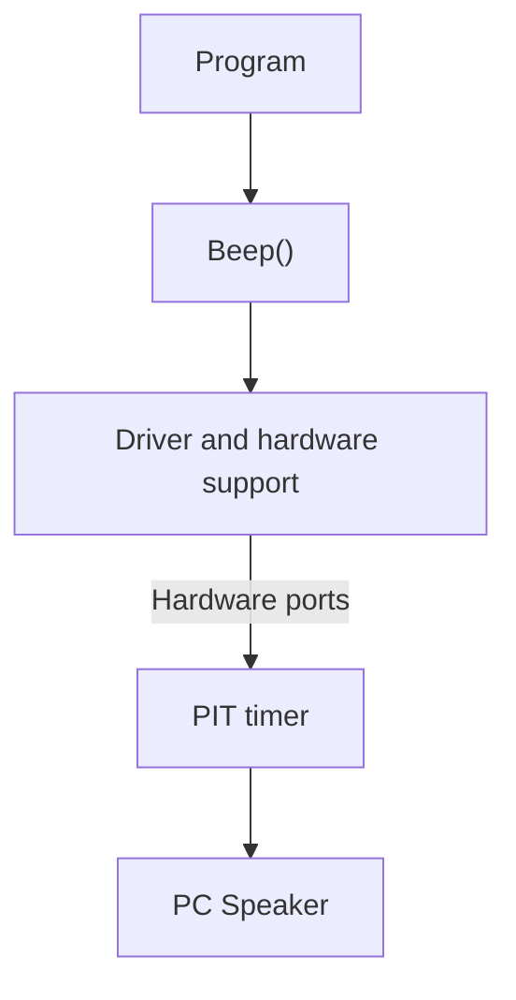
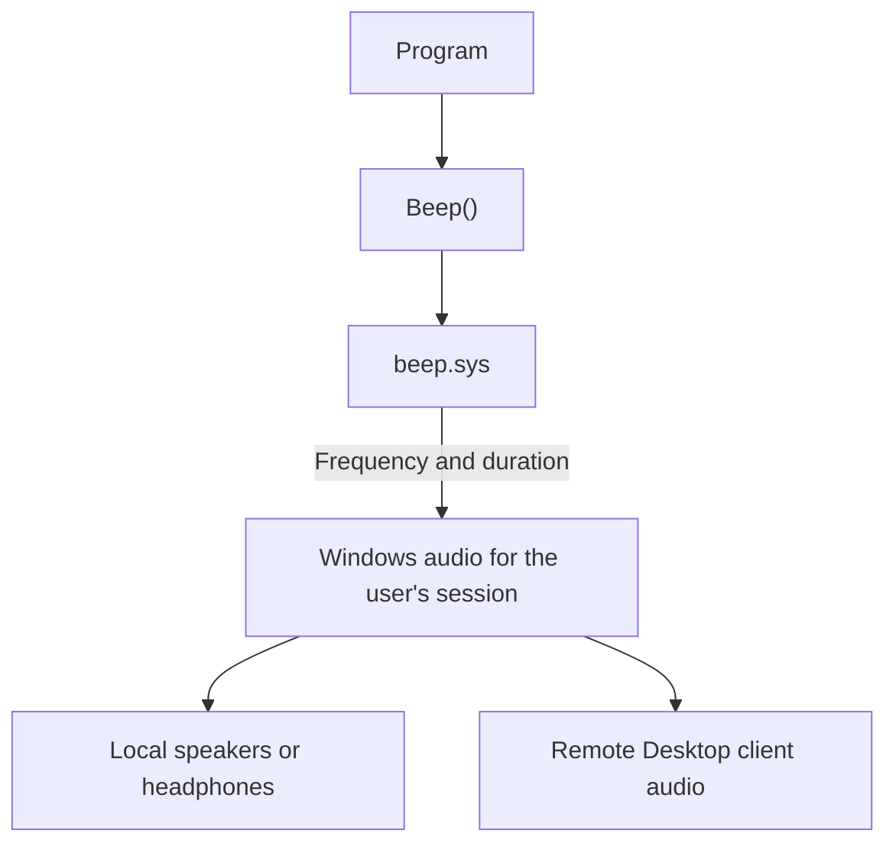

# Does beep.sys control the motherboard speaker?

I looked inside the Windows `beep.sys` driver to check whether it writes to the beeper's hardware ports to make the small system speaker, or **PC Speaker**, beep. This is an educational project: the goal is to understand how a simple beep works in Windows.

**This beep.sys does not control the beeper's hardware ports. It passes the sound settings on to the Windows audio system.** The sound can then play through regular speakers, headphones, or — during a remote connection — the computer the user is connecting from.

## Then and now

The same request — a simple beep — takes a different path.

### Older Windows: PC Speaker



### Modern Windows: session audio



This is a simplified view. Remote playback is one possible output, depending on the session and connection settings.

## Which driver is this?

| Property | Value |
| --- | --- |
| Name | `beep.sys` |
| Architecture | x86-64, Windows kernel driver |
| File version | `10.0.19041.1` |
| Size | 10,240 bytes |
| Company listed in the file | Microsoft Corporation |

Build number 19041 comes from Windows 10 version 2004 (20H1, May 2020 Update). The same file may also have been kept in later Windows releases. See the [Windows 10 release list](https://learn.microsoft.com/en-gb/windows/release-health/release-information) and Microsoft's [explanation of shared system files in versions 2004 and 20H2](https://support.microsoft.com/en-us/servicing/os/windows-10/2020/10/version-and-build-number-are-reported-incorrectly-after-you-build-a-new-windows-image-file).

SHA-256 of the file examined here:

```text
121AF03BBE6ECC1622C2540805A30AE9555EB5D5FE25B55939C045ECE7FC37EB
```

The hash lets you check whether your copy is exactly the same file. You can calculate it in PowerShell:

```powershell
Get-FileHash .\beep.sys -Algorithm SHA256
```

The file is included for educational purposes so that you can examine how it works yourself. The rights to the driver belong to Microsoft Corporation.

## License

The original text, diagrams, and other original contributions by Maciej Max are available under the [MIT License](LICENSE).

The MIT License does not cover Microsoft's `beep.sys`, code recovered from that driver, or quoted Microsoft documentation. Those materials remain the property of their respective rights holders.

## How were these files created?

### First results — April 30, 2024

If I remember correctly, I manually saved the decompiler results from [Decompiler Explorer, also known as Dogbolt](https://dogbolt.org/). The website lets you compare how different decompilers read the same file. Its source code is available in the [decompiler-explorer/decompiler-explorer](https://github.com/decompiler-explorer/decompiler-explorer) project.

These files come from that first attempt:

| File | Tool |
| --- | --- |
| `beep_angr.c` | angr |
| `beep_binaryninja.c` | Binary Ninja |
| `beep_boomerang.c` | Boomerang |
| `beep_ghidra.c` | Ghidra |
| `beep_hexray.c` | Hex-Rays |
| `beep_relyze.c` | Relyze |
| `beep_retdec.c` | RetDec |
| `beep_snowman.c` | Snowman |

Each file shows the same driver as read by a different tool.

### Recent additions

I have now added a newer Ghidra result and an assembly listing from Binary Ninja:

- `beep_ghidra_12.0.1_(0a2b6329).c` — output from Ghidra 12.0.1.
- `beep.sys_disassembly_binary_ninja.asm` — processor instructions, addresses, imported functions, and names shown in Binary Ninja.

A decompiler tries to turn machine code into something like C, which is easier to read. The ASM file shows the processor instructions. Comparing both helps explain how the driver works and spot mistakes made by the tools.

## What is wrong with the old results?

Of course, the decompiled files are not Microsoft's original source code.

A decompiler has to guess data types, variable names, and what operations mean.

- In many places, numbers showing memory offsets appear instead of field names. You still need to work out which structure they belong to.
- Hex-Rays sometimes shows `AssociatedIrp.MasterIrp`, although the way it is used points to the `AssociatedIrp.SystemBuffer` data buffer. These fields share the same space in the structure, so the tool can choose the wrong name.
- Some comments in `beep_hexray.c` are misleading. For example, `-1073741811`, or `0xC000000D`, means `STATUS_INVALID_PARAMETER`, but a comment calls it `STATUS_INVALID_DEVICE_REQUEST`. A comment like this can lead you in the wrong direction when reading the code.
- Boomerang's output looks like a misreading of the code: it contains `main`, 32-bit registers, and operations that do not fit this x64 driver. It is not a reliable basis for understanding what the driver does.
- The older Ghidra output reports problems with following jumps and recognizing some instructions. The newer output also has warnings, so updating the tool does not fix everything.
- The files contain missing headers, special types used by the decompilers, and incomplete declarations.

That is why it helps to compare several tools and look at the assembly when reading these files.

## How did it work in the past?

In older PCs, a programmable timer called the **Intel 8254 PIT**, or a compatible chip, produced a simple tone. Setting up the timer and enabling the speaker made the PC Speaker beep.

In older Windows versions, including 32-bit Windows XP and earlier releases, `Beep()` used this hardware. The driver and the system's hardware support layer set up the timer and enabled the speaker through hardware ports.

Microsoft describes this history in the [Beep function documentation](https://learn.microsoft.com/en-us/windows/win32/api/utilapiset/nf-utilapiset-beep). Support for the motherboard speaker was removed in Windows XP 64-bit and Windows Vista. Windows 7 then changed how the beep was played.

Here is the original “Remarks” section from that documentation:

> A long time ago, all PC computers shared a common 8254 programmable interval timer chip for the generation of primitive sounds. The Beep function was written specifically to emit a beep on that piece of hardware.
>
> On these older systems, muting and volume controls have no effect on Beep; you would still hear the tone. To silence the tone, you used the following commands:
>
> ```text
> net stop beep
>
> sc config beep start= disabled
> ```
>
> Since then, sound cards have become standard equipment on almost all PC computers. As sound cards became more common, manufacturers began to remove the old timer chip from computers. The chips were also excluded from the design of server computers. The result is that Beep did not work on all computers without the chip. This was okay because most developers had moved on to calling the MessageBeep function that uses whatever is the default sound device instead of the 8254 chip.
>
> Eventually because of the lack of hardware to communicate with, support for playing sound from the motherboard speaker was dropped in Windows Vista and Windows XP 64-Bit Edition.
>
> In Windows 7, Beep was rewritten to pass the beep to the default sound device for the session. This is normally the sound card, except when run under Terminal Services, in which case the beep is rendered on the client.

Source: Microsoft, [Beep function — Remarks](https://learn.microsoft.com/en-us/windows/win32/api/utilapiset/nf-utilapiset-beep).

## What does this beep.sys do?

The assembly listing contains no `in` or `out` instructions, which are used to access hardware ports. The driver does not call `HalMakeBeep` or port access functions either. Instead, it queues requests and passes the sound settings on.

In the ASM file, the function at `0x1C0001120` is named `BeepRedirectMakeBeep`. This is the function that passes on the beep settings. It works like this:

1. It finds out which user session the sound request came from.
2. It checks a queue where another part of the system is waiting for sound settings from that session.
3. It passes on the tone's frequency and duration — two 32-bit values, or 8 bytes in total.
4. It completes the waiting request so that sound playback can continue.

The driver handles two control codes, called IOCTLs:

| Code | What it does |
| --- | --- |
| `0x10000` | Accepts a sound request. |
| `0x10004` | Lets another part of the system wait for sound settings. |

The basic flow is:

```text
a program asks for a beep
        ↓
beep.sys receives the sound settings
        ↓
it passes them on to audio handling for that session
        ↓
sound playback happens outside this driver
```

If nothing is waiting for these settings, the function returns `STATUS_NOT_FOUND` (`0xC0000225`).

**This beep.sys acts as a middleman: it passes on the beep settings instead of controlling the beeper's hardware ports.**

## Where does the sound play?

Since Windows 7, `Beep()` sends the sound to the session's default audio device. Here, a session means a logged-in user's working environment, whether they are sitting at the computer or using Remote Desktop. Locally, the sound usually plays through speakers or headphones. With Terminal Services / RDP, it can play on the client computer — the one the user is connecting from. This behavior is described in the [Beep documentation](https://learn.microsoft.com/en-us/windows/win32/api/utilapiset/nf-utilapiset-beep).

For example, a program running on a remote computer calls `Beep()`, and the user hears it through headphones connected to their own computer. Playback on the client must be enabled in the connection settings. This is one example of the mechanism in use; it also works during normal local use.

That is why the driver checks the session number: the beep should reach the user whose program requested it.

This fits the way modern Windows audio works: several parts of the system share the job. Services manage playback, the audio engine processes sound, and drivers handle the devices. The [Windows Audio Architecture](https://learn.microsoft.com/en-us/windows-hardware/drivers/audio/windows-audio-architecture) page gives an overview.

In this setup, `beep.sys` passes on the request for a beep, and the rest of the Windows audio system plays the sound.

